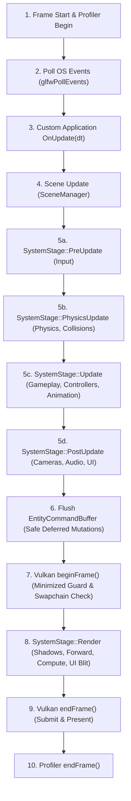

# Engine Architecture

This document describes the high-level architecture, module breakdown, and execution pipeline of the C++ Game Engine Prototype.

## System Design Overview

The engine is structured as a modular desktop application in C++20, utilizing GLFW for OS windowing/events and Vulkan for rendering. The application maintains a strict separation between core systems, resource managers, simulation systems, editor GUI, dynamic plugins, and the application bootstrap.


### Architectural Layers

1.  **Application Layer (`Application.cpp`, `SceneManager`, `DefaultScene`)**: 
    The bootstrap and lifecycle entry point. It reads runtime configurations (`project.settings`), initializes GLFW and Vulkan, instantiates the ECS Registry, binds standard systems, dynamically loads startup scenes, and orchestrates the frame loop and command buffer flushing.
2.  **Plugin Layer (`PluginManager`, `Plugin.hpp`)**:
    Dynamic shared library host. Discovers and loads `.dll` modules at runtime (e.g. `skymo_plugin.dll`, `cinemachine_plugin.dll`, `astar_plugin.dll`), registering custom ECS components, reflection metadata, systems, and editor UI inspectors via a clean C-ABI handshake.
    *   *Read more: [Dynamic Plugin Architecture](plugin_system.md)*
3.  **Entity-Component System (ECS) Layer (`Registry`, `EntityManager`, `ComponentStorage`, `EntityCommandBuffer`)**:
    A lightweight, production-grade ECS backend managing dynamic entity lifecycles, cache-friendly sparse set component allocations, deep entity cloning, and event subscriptions. Component data is stored contiguously in memory pools (`ComponentStorage`) using dynamic sparse sets and the Swap-Remove pattern.
    *   *Read more: [ECS Subsystem Guide](ecs_system.md)*
4.  **Multi-Threaded Job System (`JobSystem.hpp`, `JobSystem.cpp`)**:
    A lock-free MPMC work scheduler based on Dmitry Vyukov's ring-buffer algorithm. Delivers cooperative synchronization (`JobHandle`), batched submissions (`pushJobs`), and chunked dynamic work-stealing loops (`parallelFor`) across multicore processors.
    *   *Read more: [Job System Guide](job_system.md)*
5.  **Systems Layer (`System`, `SystemManager`, `SystemStage`)**:
    Encapsulates simulation behaviours into distinct execution stages:
    *   **PreUpdate**: `InputSystem` (OS input gathering).
    *   **PhysicsUpdate**: `PhysicsSystem` (Rigid body dynamics, bounding volumes, SAT collision detection, impulse resolution).
    *   **Update**: `PlayerControllerSystem`, `AnimationSystem` (blend trees, FK, IK), `AStarSystem`.
    *   **PostUpdate**: `CameraSystem`, `CinemachineSystem`, `AudioSystem`, `UISystem`.
    *   **Render**: `RenderSystem` (scene queueing, shader bindings, instanced drawing).
6.  **Rendering & Post-Processing Layer (`VulkanRenderer`, `PostProcessPipeline`, `ShaderCompiler`)**:
    Wraps Vulkan handles (devices, swapchains, buffers, descriptor pools, command managers, pipelines) in custom RAII classes. Manages double-buffered frame synchronization, instanced draw calls, Cascaded Shadow Maps (CSM), Screen-Space Ambient Occlusion (SSAO), HDR tone mapping, minimized window protection, and runtime shader compilation via `glslc`.
    *   *Read more: [Vulkan Renderer Guide](vulkan_renderer.md) & [Post-Processing Guide](post_process_and_shaders.md)*
7.  **Profiling Layer (`Profiler`, Tracy Integration)**:
    Provides frame history tracking, system execution samples, render stats (draw calls, triangles, VRAM), and deep microsecond flame graph integration with Tracy Profiler.
    *   *Read more: [Profiler Subsystem Guide](profiler_system.md)*
8.  **Editor Layer (`EditorUI`, `EditorModeState`, `UIBuilder`)**:
    An interactive WYSIWYG editor powered by ImGui and ImGuizmo. Enables multi-entity selection, component drag-and-drop, 3D viewport gizmos, raycast picking, node graph state machine editing, spritesheet slicing, and runtime C++ UI export. Can be disabled for standalone play.
    *   *Read more: [Editor UI Guide](editor_ui.md)*

---

## Frame Lifecycle & Execution Flow

The engine operates on a structured game loop inside `Engine::Application::run()`. The frame execution pipeline coordinates OS polling, profiling, staged ECS updates, command buffer flushing, editor panels, and Vulkan command submission:



### Core Loop Implementation (`Application::run()`)

```cpp
void Application::run() {
    onStart();

    while (running && !renderer->shouldClose()) {
        Engine::Profiler::getInstance().beginFrame();

        // 1. Poll OS windowing and input events
        glfwPollEvents();
        float dt = renderer->getDeltaTime();

        // 2. Custom game override ticks
        onUpdate(dt);

        // 3. Update scene transitions and scripting logic
        sceneManager.update(dt);
        
        // 4. Staged ECS Systems Update
        systemManager.updateStage(SystemStage::PreUpdate, dt);
        systemManager.updateStage(SystemStage::PhysicsUpdate, dt);
        systemManager.updateStage(SystemStage::Update, dt);
        systemManager.updateStage(SystemStage::PostUpdate, dt);

        // 5. Apply deferred ECS mutations before rendering
        systemManager.flushCommandBuffer(registry);
        
        // 6. Vulkan frame rendering
        if (config.enableEditor && editorUI) {
            editorUI->beginFrame();
            editorUI->drawPanels();
            
            renderSystem->drawFrame([this](VkCommandBuffer cmd) {
                editorUI->render(cmd);
            });
        } else {
            renderSystem->drawFrame();
        }

        // 7. Finalize frame profiling metrics
        Engine::Profiler::getInstance().endFrame();
    }

    onShutdown();
}
```

### Key Safety Guarantees

1. **Deferred Mutation Safety**: System execution does not directly invalidate entity iterators. Mutations recorded in `EntityCommandBuffer` are executed at a deterministic synchronization point right before rendering.
2. **Parallel Stage Execution**: Systems that do not touch overlapping component pools run concurrently across worker threads during `updateStageParallel`.
3. **Minimized Window Graceful Handling**: When the user minimizes the game window or changes resolutions, `beginFrame()` detects zero extents, safely bypassing GPU submission and preventing swapchain crashes.
