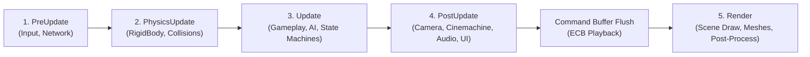

# Custom Entity-Component System (ECS)

This document provides a technical deep-dive into the engine's custom, production-ready Entity-Component System (ECS). The ECS is designed from scratch to prioritize cache locality, ultra-fast sparse-set lookups, generational entity recycling, compile-time template queries, deferred command buffering, staged system execution, and multi-threaded parallel iteration.


---

## 1. Dynamic Entity Allocation & Generational Recycling

The [Entity](../engine/include/ecs/Entity.hpp) class is a 32-bit generational handle combining a 24-bit numeric identifier with an 8-bit generation counter (`uint32_t` bit-packed). This protects against dangling references when an entity ID is recycled.

Lifetime and allocation are managed by [EntityManager.hpp](../engine/include/ecs/EntityManager.hpp):

*   **Dynamic Scalability (No Static Limit)**: Unlike earlier prototypes constrained by a static `MAX_ENTITIES = 10000`, the manager dynamically grows its capacity exponentially (`std::vector` backbones) with zero hardcoded entity ceilings.
*   **Recycling Queue**: Recycled entity indices are stored in a `std::vector<uint32_t> freeList`. When an entity is destroyed, its generation counter increments (`generation++`), and its index is returned to the pool.
*   **Dense Alive Tracking & $O(1)$ Swap-Remove**: The manager maintains a packed `std::vector<uint32_t> alive` array of active entity IDs, paired with an inverse index vector `entityToAliveIndex`. Deleting an entity performs a true $O(1)$ swap-and-pop:
    ```cpp
    uint32_t removedIdx = entityToAliveIndex[id];
    uint32_t lastId = alive.back();
    alive[removedIdx] = lastId;
    entityToAliveIndex[lastId] = removedIdx;
    alive.pop_back();
    ```
    This guarantees that retrieving active entities (`getAlive()`) is completely contiguous with zero empty slot iterations.
*   **Component Mask**: Each entity owns a 64-bit component mask (`std::bitset<64> ComponentMask`). Bit flags are accessed in $O(1)$ to determine component membership without querying component pools.

---

## 2. Dynamic Sparse Set Storage (`ComponentStorage`)

Components are pure plain-old-data (POD) structures. To achieve optimal cache locality while avoiding wasteful memory overhead, [ComponentStorage.hpp](../engine/include/ecs/ComponentStorage.hpp) implements a **Dynamic Sparse Set** architecture:

```cpp
template<typename T>
class ComponentStorage : public IStorage {
private:
    std::vector<T> dense;                             // Contiguous, tightly packed component data
    std::vector<Entity> entities;                     // Parallel vector tracking owning entities
    std::vector<uint32_t> sparse;                     // Dynamic sparse map: Entity ID -> Dense Index
};
```

### Key Sparse Set Properties

1. **$O(1)$ Random Access**: Checks and lookups (`has(e)`, `get(e)`, `tryGet(e)`) inspect `sparse[e.getId()]`. If the index is valid and `entities[denseIdx] == e`, the component reference is returned directly in constant time.
2. **Dense Memory Locality**: The `dense` vector stores all components consecutively in RAM with zero padding between inactive entities. Iteration over a single component pool achieves 100% CPU cache line utilization.
3. **$O(1)$ Swap-Remove on Deletion**: Removing a component swaps the target with the last element of `dense` and `entities`, updates the swapped entity's pointer in `sparse`, and calls `pop_back()`.
4. **Dynamic Resizing**: The `sparse` array grows automatically on demand when entities with IDs exceeding the current sparse size are assigned components.

---

## 3. Entity Command Buffer (`EntityCommandBuffer`)

Mutating the ECS topology (creating/destroying entities, adding or removing components) while iterating over views or executing systems across worker threads causes race conditions and iterator invalidation.

To make ECS operations production-ready and thread-safe, the engine provides the [`EntityCommandBuffer`](../engine/include/ecs/Registry.hpp):

```cpp
EntityCommandBuffer ecb;

// Record commands safely inside worker jobs or parallel loops
ecb.destroyEntity(enemy);
ecb.addComponent<ExplosionComponent>(posEntity, ExplosionComponent{...});
ecb.removeComponent<Velocity>(stoppedEntity);

// Play back all recorded mutations sequentially at the frame sync point
ecb.execute(registry);
```

The `SystemManager` integrates a built-in `EntityCommandBuffer`. Systems receive an ECB reference during staged execution, and `Application::run()` automatically flushes pending commands at the boundary between simulation and rendering stages.

---

## 4. Multi-Component Views & Iteration Strategies

Queries in the engine use `Registry::view<Components...>()` to filter entities possessing a specific set of components.

### Optimization: Smallest Pool Heuristic

To query entities having components `A`, `B`, and `C`, the `Registry` inspects the sizes of all participating storage pools and selects the **smallest pool** as the primary driver. Only entities in this driver pool have their component masks tested against the composite bitmask:

```cpp
template<typename First, typename Second, typename... Rest>
IStorage* getSmallestStorage() {
    IStorage* a = getStorage<First>();
    IStorage* b = getSmallestStorage<Second, Rest...>();
    if (!a) return b;
    if (!b) return a;
    return (a->size() < b->size()) ? a : b;
}
```

### Iteration Paradigms

#### 1. Range-Based For Loop (Structured Bindings)
Standard C++ forward iterator supporting concise structured bindings:
```cpp
for (auto [entity, transform, mesh] : registry.view<Transform, Mesh>()) {
    transform.position.y += 1.0f * dt;
}
```

#### 2. Direct Functional Iteration (`view.each`)
Bypasses iterator object construction and state machine checking for maximum single-threaded throughput:
```cpp
registry.view<Transform, RigidBody>().each([](Entity e, Transform& t, RigidBody& rb) {
    t.position += rb.velocity * dt;
});
```

#### 3. Multi-Threaded Parallel Iteration (`view.eachParallel`)
Distributes entity chunks across the engine's worker threads via the `JobSystem`:
```cpp
registry.view<Transform, ParticleComponent>().eachParallel(
    jobSystem,
    [](Entity e, Transform& t, ParticleComponent& p) {
        p.lifetime -= dt;
        t.position += p.velocity * dt;
    },
    chunkSize /* e.g. 64 entities per worker chunk */
);
```

---

## 5. System Execution Pipeline & System Stages

The engine defines a structured system lifecycle via the [`SystemStage`](../engine/include/ecs/System.hpp) enum:



### Lifecycle Stage Definitions

| Stage | Enum | Purpose | Standard Systems |
| :--- | :--- | :--- | :--- |
| **Pre-Update** | `SystemStage::PreUpdate` | Process input hardware events, networking packets, and initial frame setup. | `InputSystem` |
| **Physics Update** | `SystemStage::PhysicsUpdate` | Discrete timestep integration, broadphase/narrowphase collision detection, constraint solvers. | `PhysicsSystem` |
| **Update** | `SystemStage::Update` | Core gameplay logic, character controllers, procedural generation, AI pathfinding. | `PlayerControllerSystem`, `AnimationSystem`, `AStarSystem` |
| **Post-Update** | `SystemStage::PostUpdate` | Camera tracking, late animation constraints, procedural audio, UI layout reconciliation. | `CameraSystem`, `CinemachineSystem`, `AudioSystem`, `UISystem` |
| **Render** | `SystemStage::Render` | Scene rasterization, compute passes, shadow cascades, ImGui overlays. | `RenderSystem` |

### Parallel System Dispatching

Systems can declare themselves thread-safe by overriding `bool isParallelSafe() const override { return true; }`.
The `SystemManager::updateStageParallel(stage, dt, jobSystem)` schedules non-interfering systems across worker threads simultaneously using `pushJobs()`, accelerating heavy decoupled systems (such as parallel animation skinning and procedural audio updates).

---

## 6. Deep Entity Cloning (`EntityCloner`)

Duplicating entities with complex hierarchies, multiple components, and GPU resources is handled by [`EntityCloner.hpp`](../engine/include/ecs/EntityCloner.hpp):

1. **Entity Allocation**: Allocates a new entity identifier from `registry.create()`.
2. **Component Introspection**: Iterates through registered component reflection metadata in `ComponentReflectionRegistry`.
3. **Data Duplication**: Re-creates components on the clone and performs deep member copying.
4. **Name Formatting**: Increments duplicate labels (e.g. `"Orc"` becomes `"Orc (Clone)"`).
5. **GPU Asset Binding**: Safely references shared mesh/texture descriptor sets without triggering redundant VRAM allocations.
6. **Hierarchy Cloning**: Duplicates child hierarchies attached via `HierarchyComponent`, remapping parent/child references to the newly cloned entities.

---

## 7. Event Subscriptions

The [Registry](../engine/include/ecs/Registry.hpp) allows systems to subscribe to component insertion and deletion events:
```cpp
using ComponentAddedCallback = std::function<void(Entity)>;
using ComponentRemovedCallback = std::function<void(Entity)>;

registry.subscribeToAdded<Mesh>([this](Entity e) { checkAndAdd(e); });
registry.subscribeToRemoved<Mesh>([this](Entity e) { removeEntity(e); });
```
This is utilized by `RenderSystem` and spatial acceleration structures to maintain auxiliary rendering lists without per-frame entity scans.
