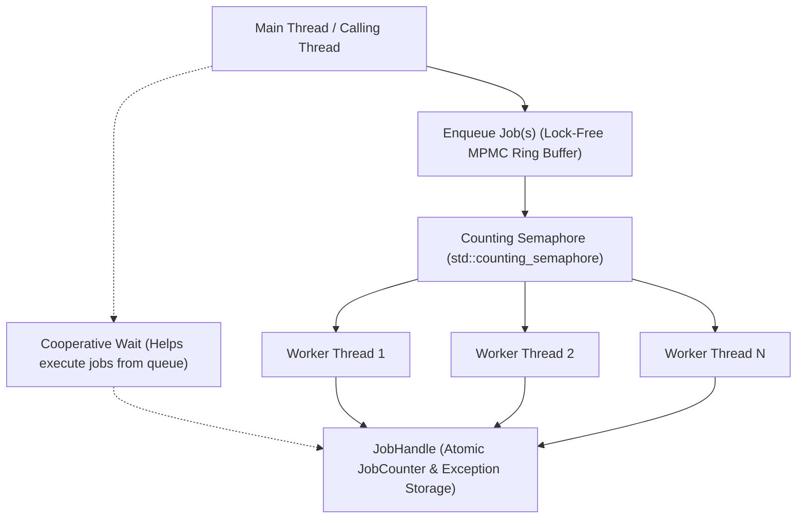

# Multi-Threaded Job System

This document outlines the architecture, data structures, and synchronization protocols of the engine's high-performance Multi-Threaded Job System. The system provides a lock-free, cooperative task scheduler designed to maximize CPU throughput across multicore processors while eliminating lock contention and priority inversion.

---

## 1. Architecture Overview

The system is encapsulated by **[JobSystem.hpp](../engine/include/core/JobSystem.hpp)** and implemented in **[JobSystem.cpp](../engine/src/core/JobSystem.cpp)** as a thread-safe singleton.



### Core Architecture Components

1. **Lock-Free MPMC Ring Buffer**: Built on Dmitry Vyukov's bounded multi-producer multi-consumer queue algorithm with $O(1)$ enqueue and dequeue operations.
2. **Worker Thread Pool**: Pre-allocated OS threads bound to hardware logical cores ($N-1$ worker threads by default, leaving one thread for the main engine loop).
3. **Cooperative Semaphore Waking**: A C++20 `std::counting_semaphore` wakes sleeping workers with zero lock overhead.
4. **Cooperative Helping on Synchronization**: When the main thread waits on a `JobHandle`, it actively steals and executes pending jobs from the queue instead of sleeping or wasting CPU cycles in spin loops.
5. **Exception Safety & Propagation**: RAII scope guards ensure tasks decrement remaining counters even if an exception is thrown. Unhandled worker exceptions are captured in `JobCounter` and rethrown to the caller of `wait(handle)` or `parallelFor`.
6. **Thread Telemetry & Diagnostics**: Native OS thread labeling (`SetThreadDescription` on Windows) and Tracy profiler instrumentation (`tracy::SetThreadName`).

---

## 2. Lock-Free Queue Mechanics (Vyukov Algorithm)

Traditional job queues protected by `std::mutex` and `std::condition_variable` suffer from severe lock contention when hundreds of small tasks are dispatched simultaneously.

The engine utilizes a power-of-two bounded circular buffer (default 4096 cells):

```cpp
struct Cell {
    std::atomic<size_t> sequence;
    std::function<void()> job;
};

std::vector<Cell> buffer;
size_t bufferMask;
std::atomic<size_t> enqueuePos{0};
std::atomic<size_t> dequeuePos{0};
```

### Enqueue Protocol
1. Load `enqueuePos`.
2. Inspect the sequence number of `buffer[enqueuePos & bufferMask]`.
3. If `sequence == enqueuePos`, attempt an atomic compare-and-swap (`compare_exchange_weak`) on `enqueuePos`.
4. Store the job closure, then advance `sequence` to `enqueuePos + 1` with `std::memory_order_release` to make it visible to consumers.
5. If the cell sequence is behind (buffer full), execute a hardware spin-pause (`_mm_pause()` or `__yield()`) before yielding.

### Dequeue Protocol
1. Load `dequeuePos`.
2. Inspect the sequence number of `buffer[dequeuePos & bufferMask]`.
3. If `sequence == dequeuePos + 1`, attempt an atomic compare-and-swap on `dequeuePos`.
4. Move the job out of the cell, then reset `sequence` to `dequeuePos + bufferMask + 1` with release semantics.
5. Execute the job outside of any critical section.

### Configurable Queue Capacity & Backpressure
The bounded circular buffer capacity is configurable at runtime via `initialize(threadCount, queueCapacity)` (defaulting to 65,536 cells, rounded up to the nearest power of two, minimum 64):

```cpp
// Initialize with custom queue capacity (e.g. for resource-constrained environments or testing)
jobSystem.initialize(4, 1024);
```

#### Distinguishing Batch Throughput from Queue Saturation
* **Batch Throughput**: Represents the rate at which the system processes high volumes of jobs over time (e.g., dispatching 8,000 or 100,000 tasks in batches). Because consumers concurrently drain cells while producers enqueue, the queue never necessarily fills up if throughput keeps pace.
* **Queue Saturation & Producer Backpressure**: Occurs when in-flight jobs reach the physical capacity limit of the ring buffer (e.g., fast concurrent producers outpacing workers). When saturated (`diff < 0`), producers enter a low-overhead hardware spin-pause loop (`_mm_pause()` or `__yield()`) followed by `std::this_thread::yield()`. This provides smooth, lock-free backpressure without packet dropping, heap allocation bursts, or deadlock.

---

## 3. Job Handles, Cooperative Waiting & Exception Safety

Tasks can be synchronized using `JobHandle`, which encapsulates an atomic task counter and thread-safe exception capture:

```cpp
using JobHandle = std::shared_ptr<JobCounter>;

struct JobCounter {
    std::atomic<int> remaining{0};
    std::atomic<bool> hasException{false};
    std::exception_ptr exception{nullptr};
    std::mutex exceptionMutex;

    void recordException(std::exception_ptr eptr) {
        if (!eptr) return;
        std::lock_guard<std::mutex> lock(exceptionMutex);
        if (!hasException.load(std::memory_order_relaxed)) {
            exception = eptr;
            hasException.store(true, std::memory_order_release);
        }
    }
};
```

### RAII Scope Guard for Completion Accounting

To prevent infinite spin hangs if a task throws an exception, all worker closures decrement the handle through an RAII scope guard:

```cpp
struct ScopeDecrement {
    JobHandle h;
    ~ScopeDecrement() {
        if (h) h->remaining.fetch_sub(1, std::memory_order_release);
    }
} guard{handle};
```

Regardless of whether the task exits normally, returns early, or throws an unhandled exception, `remaining` is guaranteed to decrement via stack unwinding.

### Cooperative Wait & Exception Rethrow

When calling `JobSystem::wait(JobHandle handle)`:

```cpp
void JobSystem::wait(const JobHandle& handle) {
    if (!handle) return;
    
    // Help execute pending jobs while waiting
    while (handle->remaining.load(std::memory_order_acquire) > 0) {
        if (!tryExecuteOneJob()) {
            for (int spin = 0; spin < 64; ++spin) {
                SPIN_PAUSE();
            }
            std::this_thread::yield();
        }
    }

    // Propagate captured exceptions to the waiting thread
    if (handle->hasException.load(std::memory_order_acquire)) {
        std::exception_ptr ex;
        {
            std::lock_guard<std::mutex> lock(handle->exceptionMutex);
            ex = handle->exception;
        }
        if (ex) {
            std::rethrow_exception(ex);
        }
    }
}
```

* **No Idle Core Waste**: The waiting thread becomes a dynamic worker, popping and executing tasks. This guarantees progress even if worker threads are temporarily preempted by the OS scheduler.
* **Immediate Error Visibility**: If a worker throws, the waiting caller immediately catches the re-thrown `std::exception` instead of experiencing mysterious hangs or deadlocks.

---

## 4. Parallel For & Chunked Work Stealing

The primary API for parallelizing data loops is `parallelFor`:

```cpp
void parallelFor(int count, std::function<void(int)> func, int chunkSize = 0);
```

### Dynamic Chunking & Atomic Contention Elimination

Naive parallel loops enqueue one task per index or perform atomic increments on single indices:
$$\text{Index} = \text{atomic.fetch\_add}(1)$$
With thousands of elements, this causes severe atomic cache line bouncing across CPU L3 caches.

The engine's `parallelFor` uses **chunked dynamic partitioning**:

```cpp
if (chunkSize <= 0) {
    int autoChunk = (std::max)(1, count / static_cast<int>(numThreads * 8));
    chunkSize = (std::clamp)(autoChunk, 1, 128);
}

std::atomic<int> nextIndex{0};
auto handle = std::make_shared<JobCounter>();
handle->remaining.store(static_cast<int>(numThreads), std::memory_order_release);

for (unsigned int w = 0; w < numThreads; ++w) {
    pushJob([&func, count, chunkSize, &nextIndex, handle]() {
        struct ScopeDecrement {
            JobHandle h;
            ~ScopeDecrement() {
                if (h) h->remaining.fetch_sub(1, std::memory_order_release);
            }
        } guard{handle};

        try {
            while (true) {
                int start = nextIndex.fetch_add(chunkSize, std::memory_order_relaxed);
                if (start >= count) break;
                int end = (std::min)(start + chunkSize, count);
                for (int i = start; i < end; ++i) {
                    func(i);
                }
            }
        } catch (...) {
            handle->recordException(std::current_exception());
        }
    });
}

wait(handle);
```

### Advantages of Dynamic Chunking
1. **Load Balancing**: Faster cores automatically claim more chunks via `fetch_add(chunkSize)`.
2. **Minimal Bus Contention**: Workers make $\frac{N}{\text{chunkSize}}$ atomic operations instead of $N$.
3. **Zero Deadlock Risk**: Coordinated by the cooperative `wait()` loop.
4. **Exception-Safe Accounting**: Exceptions inside `func(i)` do not skip completion decrements.

### Explicit Exception Semantics: Non-Transactional Partial Execution
When an iteration throws an exception within `parallelFor()`:
* **Asynchronous Execution**: Other worker threads may continue running their assigned chunks while the failing thread records the exception into the `JobCounter` and terminates its loop.
* **Non-Transactional Side Effects**: `parallelFor()` is **not transactional**. Any state mutations performed by iterations preceding the failure or running concurrently on other workers have already taken effect in memory.
* **No Blind Retries**: When `wait(handle)` finishes and rethrows the captured exception to the caller, the caller must recognize that execution was **partial**. Blindly retrying the full range `[0, count)` without reconciling partially modified data may result in duplicated side effects or corruption.

---

## 5. Batch Job Enqueueing (`pushJobs`)

For submitting multiple independent tasks simultaneously, `pushJobs` enqueues an entire list of jobs while incrementally publishing waking signals to the worker semaphore:

```cpp
std::vector<std::function<void()>> batch;
batch.reserve(tasks.size());
for (auto& task : tasks) {
    batch.push_back([task]() { task.run(); });
}
JobHandle batchHandle = jobSystem.pushJobs(batch);
jobSystem.wait(batchHandle);
```

### Deadlock Prevention for Batches Exceeding Queue Capacity
When submitting a large batch whose size exceeds the bounded ring-buffer capacity (e.g. 1,024 jobs submitted into a 128-cell queue):
* **Incremental Publishing**: `pushJobs` tracks an `unnotified` counter and wakes worker threads incrementally (every 16 jobs or `bufferMask / 4`) instead of waiting until the end of the entire batch.
* **Immediate Backpressure Release**: If the producer encounters a full queue (`diff < 0`), it immediately flushes any unnotified jobs to `jobSemaphore.release()` before entering the spin-pause / yield loop.
* **Continuous Draining**: Sleeping workers are guaranteed to be awake and consuming jobs from the buffer, continuously opening slots for the producer. This completely prevents producer-consumer deadlocks and guarantees exact $1:1$ semaphore accounting.

---

## 6. Profiler & Debugger Integration

* **Windows Debugger**: Every worker thread calls `SetThreadDescription(GetCurrentThread(), L"JobWorker #X")`, allowing Visual Studio and WinDbg threads windows to display clear names instead of arbitrary thread IDs.
* **Tracy Profiler**: Automatically registers worker threads via `tracy::SetThreadName("JobWorker #X")` for detailed flame chart analysis.
* **Telemetry Counters**: Tracks cumulative workload metrics (`getTotalJobsSubmitted()`, `getTotalJobsExecuted()`).
