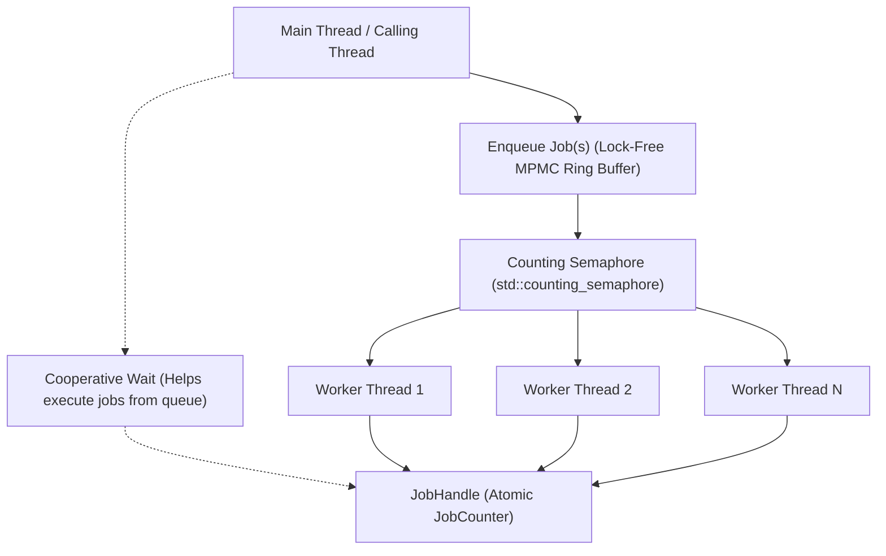

# Multi-Threaded Job System

This document outlines the architecture, data structures, and synchronization protocols of the engine's high-performance Multi-Threaded Job System. The system provides a lock-free, cooperative task scheduler designed to maximize CPU throughput across multicore processors while eliminating lock contention and priority inversion.

---

## 1. Architecture Overview

The system is encapsulated by **[JobSystem.hpp](../engine/include/core/JobSystem.hpp)** and implemented in **[JobSystem.cpp](../engine/src/core/JobSystem.cpp)** as a thread-safe singleton.



### Core Architecture Components

1. **Lock-Free MPMC Ring Buffer**: Built on Dmitry Vyukov's bounded multi-producer multi-consumer queue algorithm with $O(1)$ enqueue and dequeue operations.
2. **Worker Thread Pool**: Pre-allocated OS threads bound to hardware logical cores ($N-1$ worker threads by default, leaving one thread for the main engine loop).
3. **Cooperative Semaphore Waking**: A C++20 `std::counting_semaphore` wakes sleeping workers with zero lock overhead.
4. **Cooperative Helping on Synchronization**: When the main thread waits on a `JobHandle`, it actively steals and executes pending jobs from the queue instead of sleeping or wasting CPU cycles in spin loops.
5. **Thread Telemetry & Diagnostics**: Native OS thread labeling (`SetThreadDescription` on Windows) and Tracy profiler instrumentation (`tracy::SetThreadName`).

---

## 2. Lock-Free Queue Mechanics (Vyukov Algorithm)

Traditional job queues protected by `std::mutex` and `std::condition_variable` suffer from severe lock contention when hundreds of small tasks are dispatched simultaneously.

The engine utilizes a power-of-two bounded circular buffer (default 4096 cells):

```cpp
struct Cell {
    std::atomic<size_t> sequence;
    std::function<void()> job;
};

std::vector<Cell> buffer;
size_t bufferMask;
std::atomic<size_t> enqueuePos{0};
std::atomic<size_t> dequeuePos{0};
```

### Enqueue Protocol
1. Load `enqueuePos`.
2. Inspect the sequence number of `buffer[enqueuePos & bufferMask]`.
3. If `sequence == enqueuePos`, attempt an atomic compare-and-swap (`compare_exchange_weak`) on `enqueuePos`.
4. Store the job closure, then advance `sequence` to `enqueuePos + 1` with `std::memory_order_release` to make it visible to consumers.
5. If the cell sequence is behind (buffer full), execute a hardware spin-pause (`_mm_pause()` or `__yield()`) before yielding.

### Dequeue Protocol
1. Load `dequeuePos`.
2. Inspect the sequence number of `buffer[dequeuePos & bufferMask]`.
3. If `sequence == dequeuePos + 1`, attempt an atomic compare-and-swap on `dequeuePos`.
4. Move the job out of the cell, then reset `sequence` to `dequeuePos + bufferMask + 1` with release semantics.
5. Execute the job outside of any critical section.

---

## 3. Job Handles & Cooperative Waiting

Tasks can be synchronized using `JobHandle`, which encapsulates a reference-counted atomic task counter:

```cpp
using JobHandle = std::shared_ptr<JobCounter>;

struct JobCounter {
    std::atomic<int> remaining{0};
};
```

### Cooperative Wait Implementation

When calling `JobSystem::wait(JobHandle handle)`:

```cpp
void JobSystem::wait(const JobHandle& handle) {
    if (!handle) return;
    
    // Help execute pending jobs while waiting
    while (handle->remaining.load(std::memory_order_acquire) > 0) {
        if (!tryExecuteOneJob()) {
            for (int spin = 0; spin < 64; ++spin) {
                SPIN_PAUSE();
            }
            std::this_thread::yield();
        }
    }
}
```

* **No Idle Core Waste**: The waiting thread becomes a dynamic worker, popping and executing tasks. This guarantees progress even if worker threads are temporarily preempted by the OS scheduler.
* **Hardware Spin Backoff**: If no work is currently available in the queue, it performs low-power hardware pause instructions (`_mm_pause()` on x86/x64, `__yield()` on ARM) before yielding its timeslice.

---

## 4. Parallel For & Chunked Work Stealing

The primary API for parallelizing data loops is `parallelFor`:

```cpp
void parallelFor(int count, std::function<void(int)> func, int chunkSize = 0);
```

### Dynamic Chunking & Atomic Contention Elimination

Naive parallel loops enqueue one task per index or perform atomic increments on single indices:
$$\text{Index} = \text{atomic.fetch\_add}(1)$$
With thousands of elements, this causes severe atomic cache line bouncing across CPU L3 caches.

The engine's `parallelFor` uses **chunked dynamic partitioning**:

```cpp
if (chunkSize <= 0) {
    int autoChunk = std::max(1, count / static_cast<int>(numThreads * 8));
    chunkSize = std::clamp(autoChunk, 1, 128);
}

std::atomic<int> nextIndex{0};
auto handle = std::make_shared<JobCounter>();
handle->remaining.store(static_cast<int>(numThreads), std::memory_order_release);

for (unsigned int w = 0; w < numThreads; ++w) {
    pushJob([&func, count, chunkSize, &nextIndex, handle]() {
        while (true) {
            int start = nextIndex.fetch_add(chunkSize, std::memory_order_relaxed);
            if (start >= count) break;
            int end = std::min(start + chunkSize, count);
            for (int i = start; i < end; ++i) {
                func(i);
            }
        }
        handle->remaining.fetch_sub(1, std::memory_order_release);
    });
}

wait(handle);
```

### Advantages of Dynamic Chunking
1. **Load Balancing**: Faster cores automatically claim more chunks via `fetch_add(chunkSize)`.
2. **Minimal Bus Contention**: Workers make $\frac{N}{\text{chunkSize}}$ atomic operations instead of $N$.
3. **Zero Deadlock Risk**: Coordinated by the cooperative `wait()` loop.

---

## 5. Batch Job Enqueueing (`pushJobs`)

For submitting multiple independent tasks simultaneously, `pushJobs` enqueues an entire list of jobs in a tight loop and signals the worker semaphore once, reducing kernel transition overhead:

```cpp
std::vector<std::function<void()>> batch;
batch.reserve(tasks.size());
for (auto& task : tasks) {
    batch.push_back([task]() { task.run(); });
}
JobHandle batchHandle = jobSystem.pushJobs(batch);
jobSystem.wait(batchHandle);
```

---

## 6. Profiler & Debugger Integration

* **Windows Debugger**: Every worker thread calls `SetThreadDescription(GetCurrentThread(), L"JobWorker #X")`, allowing Visual Studio and WinDbg threads windows to display clear names instead of arbitrary thread IDs.
* **Tracy Profiler**: Automatically registers worker threads via `tracy::SetThreadName("JobWorker #X")` for detailed flame chart analysis.
* **Telemetry Counters**: Tracks cumulative workload metrics (`getTotalJobsSubmitted()`, `getTotalJobsExecuted()`).
