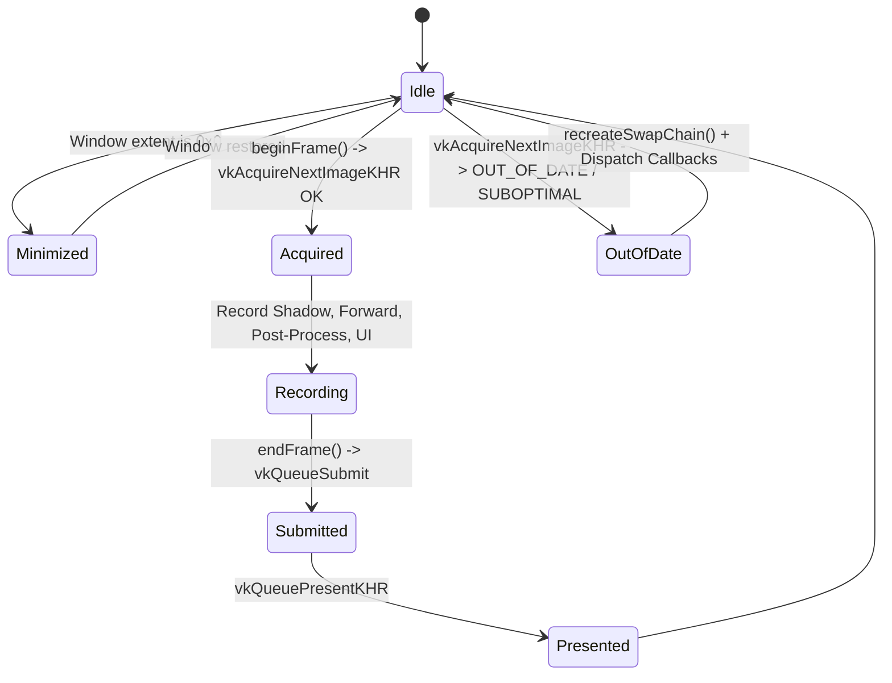
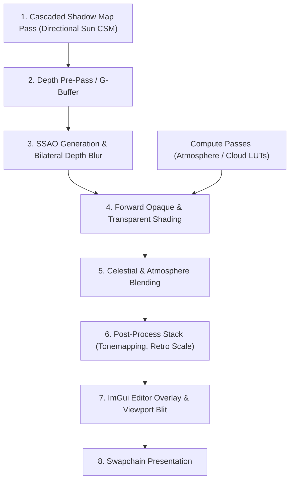

# Vulkan Rendering Engine

This document details the graphics architecture of the Vulkan Renderer. The renderer is designed to abstract raw Vulkan API complexity into clean, RAII C++ wrapper classes while preserving maximum performance, supporting instanced drawing, Cascaded Shadow Maps (CSM), compute shader passes, Screen-Space Ambient Occlusion (SSAO), a modular post-processing pipeline, and robust frame lifecycle synchronization.


---

## 1. Vulkan Abstraction Layer

Vulkan requires explicit declaration of resources, layouts, synchronization, and hardware access. The engine implements a set of object-oriented C++ classes under `engine/src/core/` to safely encapsulate Vulkan handles:

*   **[VulkanContext](../engine/src/core/VulkanContext.hpp)**: Stores instance-wide structures, validation layer callbacks, and physical device enumerations.
*   **[VulkanDevice](../engine/src/core/VulkanDevice.hpp)**: Handles hardware physical device selection (prioritizing discrete GPUs) and logical device creation. Configures queue families for graphics, presentation, compute, and transfers.
*   **[VulkanSwapchain](../engine/src/core/VulkanSwapChain.hpp)**: Manages screen resolution changes, double-buffering image chains, render pass configurations, swapchain image views, and framebuffers.
*   **[VulkanPipeline](../engine/src/core/VulkanPipeline.hpp)**: Coordinates shader layout state bindings, viewport/scissor setup, depth/stencil tests, color blending, rasterization, and multi-sampling configurations.
*   **[VulkanBuffer](../engine/src/core/VulkanBuffer.hpp)**: Encapsulates `VkBuffer` allocation and `VkDeviceMemory` binding. Supports staging allocations, GPU-local transfer operations, and persistent host mapping.
*   **[VulkanDescriptors](../engine/src/core/VulkanDescriptors.hpp)**: Standardizes descriptor layouts, bindings, pools, and set allocations for camera matrices, compute LUTs, and global uniforms.
*   **[VulkanCommandManager](../engine/src/core/VulkanCommandManager.hpp)**: Creates command pools and records frame buffer command sequences. Supports one-time command buffer execution for staging buffer uploads.
*   **[VulkanFrameSync](../engine/src/core/VulkanFrameSync.hpp)**: Holds CPU-GPU synchronization elements, preventing race conditions via fences and swapchain image-acquisition semaphores.

---

## 2. Frame Lifecycle State Machine & Synchronization

In production environments, OS events such as window minimizing (0x0 extent), drag-resizing, display adapter unplugging, or full-screen toggling can trigger swapchain invalidation (`VK_ERROR_OUT_OF_DATE_KHR` or `VK_SUBOPTIMAL_KHR`). Submitting draw commands to an invalid or un-acquired swapchain causes Vulkan driver crashes and device loss (`VK_ERROR_DEVICE_LOST`).

The engine enforces a rigorous frame state machine in [VulkanRenderer.cpp](../engine/src/VulkanRenderer.cpp):



### Lifecycle Guarantees (`beginFrame` & `endFrame`)

1. **Minimized Window Protection**:
   ```cpp
   int width = 0, height = 0;
   glfwGetFramebufferSize(context->getWindow(), &width, &height);
   if (width == 0 || height == 0) {
       return false; // Skip drawing, do not record or submit invalid frames
   }
   ```
2. **Atomic Frame Activity Guard (`m_frameActive`)**:
   `beginFrame()` returns a `bool`. If image acquisition fails or the window is minimized, `m_frameActive` remains `false`. `endFrame()` verifies this flag and safely aborts if no frame was actively begun.
3. **Double-Buffered CPU-GPU Synchronization**:
   ```cpp
   vkWaitForFences(device->getLogicalDevice(), 1, &sync->inFlightFences[currentFrame], VK_TRUE, UINT64_MAX);
   // Image acquisition with imageAvailableSemaphore
   // Only reset fence AFTER successful acquisition
   vkResetFences(device->getLogicalDevice(), 1, &sync->inFlightFences[currentFrame]);
   ```
4. **Swapchain Recreation Event Dispatch**:
   Subsystems that maintain resolution-dependent framebuffers (e.g., Post-Process Pipeline, SSAO, Scene Viewport, UI cameras) register recreation listeners:
   ```cpp
   renderer.addSwapchainRecreatedCallback([](uint32_t width, uint32_t height) {
       // Resize HDR offscreen render targets and camera aspect ratios
   });
   ```

---

## 3. Multipass Rendering Architecture

The frame rendering pipeline coordinates multiple distinct rendering stages:



### 1. Cascaded Shadow Mapping (CSM)
* **Frustum Splitting**: Slices camera frustum into up to 4 cascades using a practical logarithmic/uniform split lambda ($\lambda = 0.85$).
* **Filtering**: 16-tap Poisson disk filtering or 3x3 PCF eliminates harsh shadow stair-stepping.
* **Biasing**: Normal-offset geometric bias prevents shadow acne and detached shadows.

### 2. Screen-Space Ambient Occlusion (SSAO)
* Generates realistic contact shadows by sampling hemispherical normal-aligned kernels against the depth buffer.
* Bilateral depth-aware blur eliminates kernel noise without blurring across object boundaries.

### 3. Compute Shader Infrastructure
* The engine natively supports compute pipelines (`VK_PIPELINE_BIND_POINT_COMPUTE`).
* Powers real-time atmospheric scattering LUTs (Transmittance, Multi-Scattering, SkyView, 3D Aerial Perspective, and 3D Cloud Noise).

### 4. Post-Processing Pipeline (`PostProcessPipeline`)
* Chain of fullscreen fragment passes operating on HDR offscreen color buffers.
* Supports photographic tonemapping (ACES, AgX, Filmic, Reinhard), custom fullscreen effects, and retro downsampling with nearest-neighbor upscaling.

---

## 4. Runtime Shader Compiler (`ShaderCompiler`)

Shaders are written in GLSL and compiled to SPIR-V. The engine features an integrated runtime compiler ([`ShaderCompiler.hpp`](../engine/include/renderer/ShaderCompiler.hpp)):
* **glslc Integration**: Automatically locates the compiler via `VULKAN_SDK` or `PATH`.
* **Smart Timestamp Caching**: Compares modification timestamps of `.vert`, `.frag`, and `.comp` files against output `.spv` files. Unchanged shaders are loaded instantly from disk.
* **Live Hot Reloading**: Shaders can be edited and recompiled while the engine is running, logging compiler warnings and errors directly to the editor console.

---

## 5. Instanced Drawing & Push Constants

For optimal draw call throughput, the renderer groups entities by **Mesh + Material combination**:

### Per-Instance Data via Push Constants
Instead of allocating costly dynamic uniform buffers, the engine passes model matrices and tint colors directly through high-speed GPU push constant registers:

```cpp
struct PushConstants {
    glm::mat4 model;  // Entity transformation matrix
    glm::vec4 color;  // Base tint color
};
```

---

## 6. Rendering Performance Metrics (`RenderMetrics`)

The renderer gathers per-frame metrics accessible via `renderer.getMetrics()`:
* **Draw Calls**: Number of `vkCmdDraw` and `vkCmdDrawIndexed` submissions in the current frame.
* **Triangle Count**: Total primitive count rasterized.
* **Vertex Count**: Total vertices processed.
* **Frame Index**: Monotonically increasing frame identifier for temporal effects and jittering.
